# Manual técnico — Práctica 2
## Red de la Ciudad Comercial Cayalá

**Curso:** Redes de Computadoras 1  
**Estudiante:** Ángel Emanuel Rodriguez Corado  
**Registro académico:** 202404856  
**Periodo:** Segundo semestre de 2026  
**Herramienta:** Cisco Packet Tracer


## 1. Objetivo y alcance

Implementar una red de switches para cinco establecimientos de Cayalá con segmentación por VLAN, enlaces troncales IEEE 802.1Q, VTP, Rapid PVST+, EtherChannel LACP y comunicación entre VLANs. La topología utiliza switches 3560 como principales y 2960 para acceso.

Se representó cada switch de acceso con una computadora de prueba y cada establecimiento con un servidor. Las subredes se dimensionaron para las cantidades de hosts previstas en el enunciado; no se colocaron físicamente los 157 equipos solicitados como demanda de hosts.

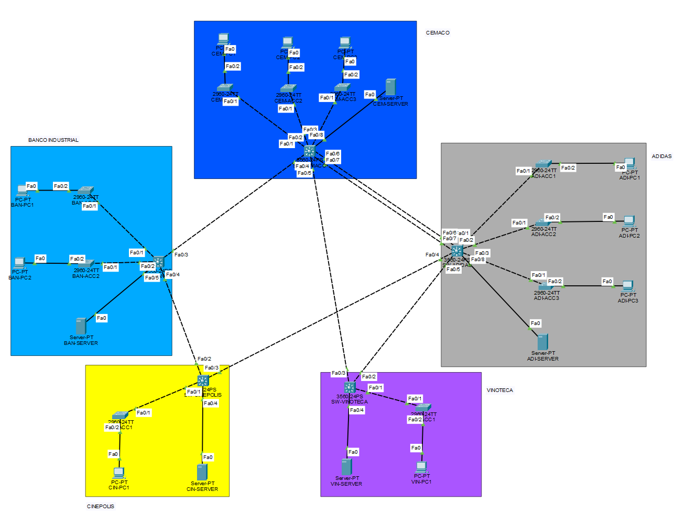

## 2. Establecimientos y criterios de diseño

| Zona | Establecimiento | VLAN | Hosts necesarios | Actividad y criterio de diseño |
|---|---|---:|---:|---|
| 1 | CEMACO | 16 | 60 | Comercio; mayor cantidad de usuarios, tres switches de acceso y conexión redundante al resto de la red. |
| 2 | Banco Industrial | 26 | 28 | Servicios financieros; demanda de conectividad confiable y dos switches de acceso. |
| 3 | Cinépolis | 36 | 12 | Servicios de entretenimiento; un switch de acceso y dos enlaces troncales desde el principal. |
| 4 | Adidas | 46 | 50 | Comercio; demanda elevada, tres switches de acceso y EtherChannel redundante con CEMACO. |
| 5 | Vinoteca | 56 | 7 | Comercio; un switch de acceso, conectado al anillo de distribución. |

Los volúmenes de tráfico y niveles de criticidad se justifican cualitativamente según el tipo de establecimiento y los hosts requeridos. No se realizaron mediciones de tráfico real.

## 3. Equipamiento

| Tipo | Modelo | Cantidad | Función |
|---|---|---:|---|
| Switch principal | Cisco 3560 | 5 | Interconexión de zonas; SW-CEMACO realiza el enrutamiento inter-VLAN. |
| Switch de acceso | Cisco 2960 | 10 | Conexión de computadoras de cada zona. |
| Computadora | PC-PT | 10 | Una por cada switch de acceso. |
| Servidor | Server-PT | 5 | Un servidor por establecimiento; conectividad IP comprobada. |

**Nota:** la presencia de un `Server-PT` no implica que se haya configurado un servicio HTTP, DNS o DHCP. Las pruebas realizadas verifican conectividad IP.

## 4. Topología híbrida y enlaces

### 4.1 Estructura general

Se combinan dos disposiciones:

- **Estrella extendida:** cada switch principal enlaza a los switches de acceso de su establecimiento, ejemplo el establecimiento de ADIDAS

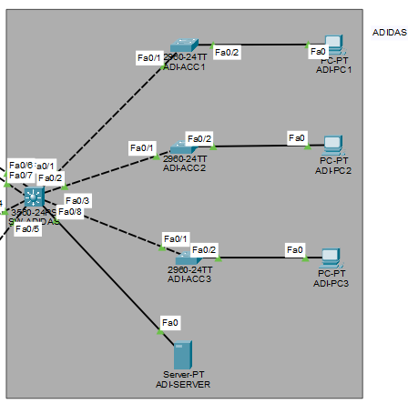

- **Anillo redundante entre switches principales:** SW-CEMACO → SW-BANCO → SW-CINEPOLIS → SW-ADIDAS → SW-VINOTECA → SW-CEMACO. Además, SW-CEMACO y SW-ADIDAS disponen de dos enlaces físicos agrupados en `Port-channel1` mediante LACP.

El anillo y el canal agregado ofrecen alternativas físicas de comunicación. Rapid PVST+ selecciona los enlaces activos por VLAN para evitar bucles; redundancia física no significa que todos los enlaces reenvíen simultáneamente para todas las VLANs.

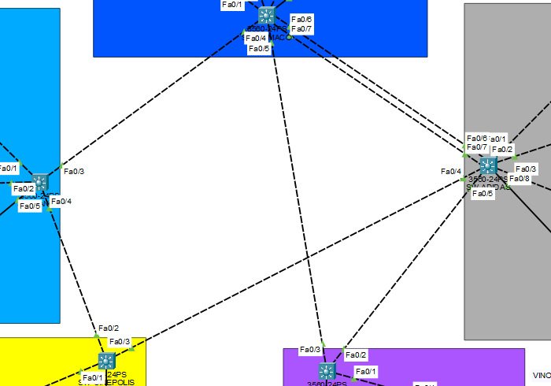

### 4.2 Conexiones principales

| Origen | Puerto | Destino | Puerto | Tipo |
|---|---|---|---|---|
| SW-CEMACO | Fa0/4 | SW-BANCO | Fa0/3 | Trunk |
| SW-BANCO | Fa0/4 | SW-CINEPOLIS | Fa0/2 | Trunk |
| SW-CINEPOLIS | Fa0/3 | SW-ADIDAS | Fa0/4 | Trunk |
| SW-ADIDAS | Fa0/5 | SW-VINOTECA | Fa0/2 | Trunk |
| SW-VINOTECA | Fa0/3 | SW-CEMACO | Fa0/5 | Trunk |
| SW-CEMACO | Fa0/6–Fa0/7 | SW-ADIDAS | Fa0/6–Fa0/7 | LACP / Po1 |

### 4.3 Conexiones de acceso y servidores

| Principal | Puertos | Equipos conectados | VLAN de acceso |
|---|---|---|---:|
| SW-CEMACO | Fa0/1–Fa0/3 | CEM-ACC1, CEM-ACC2, CEM-ACC3 | 16 |
| SW-CEMACO | Fa0/8 | CEM-SERVER | 16 |
| SW-BANCO | Fa0/1–Fa0/2 | BAN-ACC1, BAN-ACC2 | 26 |
| SW-BANCO | Fa0/5 | BAN-SERVER | 26 |
| SW-CINEPOLIS | Fa0/1 | CIN-ACC1 | 36 |
| SW-CINEPOLIS | Fa0/4 | CIN-SERVER | 36 |
| SW-ADIDAS | Fa0/1–Fa0/3 | ADI-ACC1, ADI-ACC2, ADI-ACC3 | 46 |
| SW-ADIDAS | Fa0/8 | ADI-SERVER | 46 |
| SW-VINOTECA | Fa0/1 | VIN-ACC1 | 56 |
| SW-VINOTECA | Fa0/4 | VIN-SERVER | 56 |

Las computadoras se conectan mediante FastEthernet0 a Fa0/2 de cada switch de acceso. Se utilizan cables *straight-through* para equipos finales–switch y medios adecuados a enlaces entre switches, según la simulación y el estándar TIA/EIA-568B solicitado.

## 5. VLANs y direccionamiento IPv4

El último dígito del registro académico es **6**; por ello las VLANs de zona son 16, 26, 36, 46 y 56. Se configuraron adicionalmente VLAN 99 (nativa) y 999 (Blackhole).

| Establecimiento | VLAN | Subred | Máscara | Gateway (SVI en SW-CEMACO) | Hosts requeridos |
|---|---:|---|---|---|---:|
| CEMACO | 16 | 192.168.16.0/26 | 255.255.255.192 | 192.168.16.1 | 60 |
| Banco Industrial | 26 | 192.168.26.0/27 | 255.255.255.224 | 192.168.26.1 | 28 |
| Cinépolis | 36 | 192.168.36.0/28 | 255.255.255.240 | 192.168.36.1 | 12 |
| Adidas | 46 | 192.168.46.0/26 | 255.255.255.192 | 192.168.46.1 | 50 |
| Vinoteca | 56 | 192.168.56.0/28 | 255.255.255.240 | 192.168.56.1 | 7 |

**Aclaración sobre capacidad:** la tabla anterior reproduce la demanda del enunciado. Las subredes /26 admiten 62 direcciones utilizables, /27 admite 30 y /28 admite 14. Al reservar una dirección de gateway y otra de servidor, las cinco subredes todavía pueden alojar las cantidades de computadoras previstas (60, 28, 12, 50 y 7 respectivamente).

### 5.1 Equipos realmente colocados en la simulación

| Equipo | Dirección IP | Gateway |
|---|---|---|
| CEM-PC1 / CEM-PC2 / CEM-PC3 | 192.168.16.2 / .3 / .4 | 192.168.16.1 |
| BAN-PC1 / BAN-PC2 | 192.168.26.2 / .3 | 192.168.26.1 |
| CIN-PC1 | 192.168.36.2 | 192.168.36.1 |
| ADI-PC1 / ADI-PC2 / ADI-PC3 | 192.168.46.2 / .3 / .4 | 192.168.46.1 |
| VIN-PC1 | 192.168.56.2 | 192.168.56.1 |
| CEM-SERVER | 192.168.16.62 | 192.168.16.1 |
| BAN-SERVER | 192.168.26.30 | 192.168.26.1 |
| CIN-SERVER | 192.168.36.14 | 192.168.36.1 |
| ADI-SERVER | 192.168.46.52 | 192.168.46.1 |
| VIN-SERVER | 192.168.56.9 | 192.168.56.1 |

### 5.2 Seguridad y enlaces troncales

- VLAN 99: nativa de los trunks 802.1Q.
- VLAN 999: puertos físicos sin uso; deshabilitados administrativamente.
- Uplinks de acceso: únicamente VLAN de zona y VLAN 99 (por ejemplo, CEM-ACC1 usa `16,99`).
- Enlaces entre principales y Po1: permiten expresamente `16,26,36,46,56,99`; no se utiliza `allowed vlan all`.

## 6. VTP

Se verificó la configuración VTP de los **cinco switches principales** mediante `show vtp status`, `show vtp password` y `show vlan brief`. Los cinco operan en modo **Server**, como requiere la sección 3.3.2 del enunciado para los switches principales de zona.

### 6.1 Parámetros comprobados

| Parámetro | Valor verificado |
|---|---|
| Dominio VTP | `202404856` |
| Versión en ejecución | 2 |
| Contraseña VTP | `Cayala2026` |
| VTP Pruning | Disabled |
| VLANs existentes | 12, incluyendo las predeterminadas |
| Configuration Revision | 29 |
| MD5 digest | `06 84 78 E3 D1 7E FC D3 1C 3C 8A 6D 65 69 45 62` |

### 6.2 Verificación individual de switches principales

| Switch | Modo | Versión | Revisión | VLANs | Dirección del servidor conectado |
|---|---|---:|---:|---:|---|
| SW-CEMACO | Server | 2 | 29 | 12 | Fa0/8 en VLAN 16 |
| SW-BANCO | Server | 2 | 29 | 12 | Fa0/5 en VLAN 26 |
| SW-CINEPOLIS | Server | 2 | 29 | 12 | Fa0/4 en VLAN 36 |
| SW-ADIDAS | Server | 2 | 29 | 12 | Fa0/8 en VLAN 46 |
| SW-VINOTECA | Server | 2 | 29 | 12 | Fa0/4 en VLAN 56 |

Los cinco switches muestran las mismas VLANs 16 (CEMACO), 26 (BANCO), 36 (CINEPOLIS), 46 (ADIDAS), 56 (VINOTECA), 99 (NATIVA) y 999 (BLACKHOLE), además de las VLANs predeterminadas 1 y 1002–1005. La igualdad del dominio, contraseña, revisión y digest MD5 respalda la coherencia de sus bases de datos VTP al momento de la comprobación.

Los **switches de acceso** se habían configurado como clientes VTP durante la implementación. La presente verificación se centró en los cinco principales; para respaldar el requisito de clientes con capturas finales, se recomienda obtener `show vtp status` de al menos un switch de acceso por establecimiento.

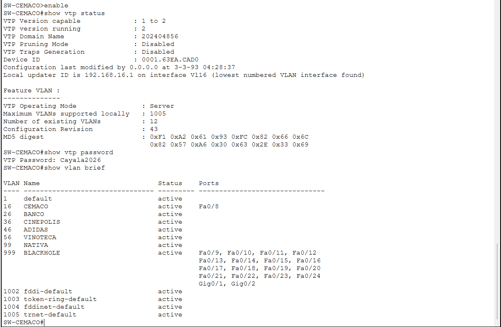
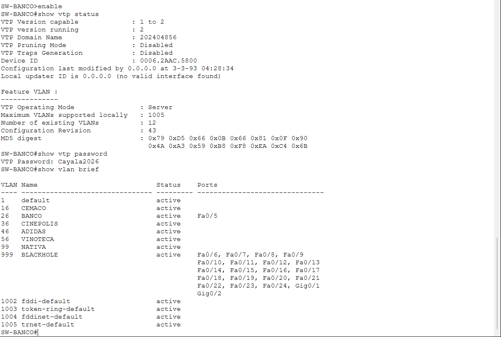
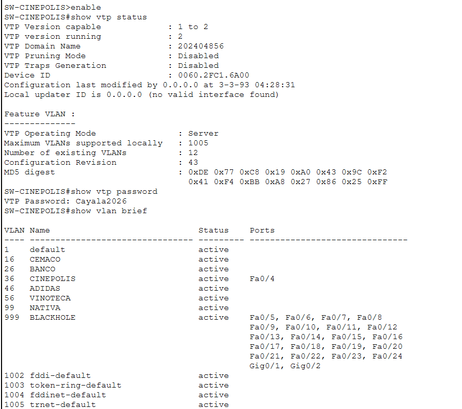
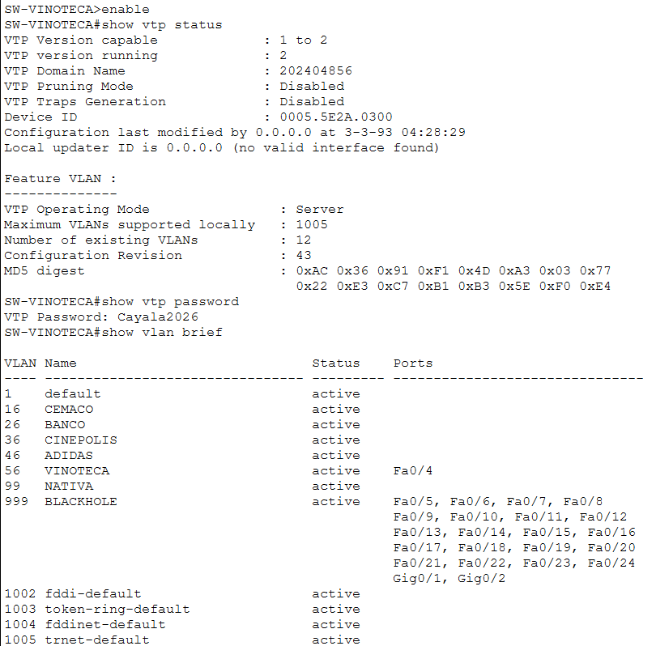
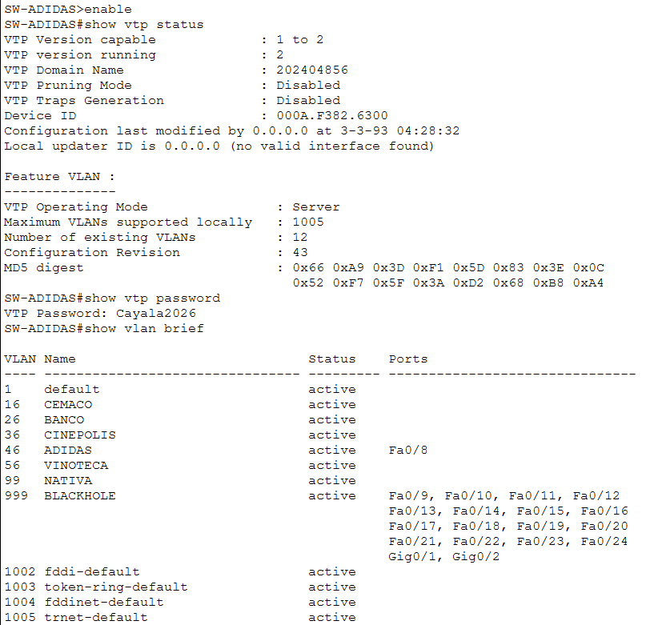

## 7. Rapid PVST+

Se implementó Rapid PVST+ en los switches y se asignó explícitamente prioridad baja al principal correspondiente a cada VLAN.

| VLAN | Root Bridge | Prioridad configurada | Prioridad efectiva (incluye VLAN ID) |
|---:|---|---:|---:|
| 16 | SW-CEMACO | 4096 | 4112 |
| 26 | SW-BANCO | 8192 | 8218 |
| 36 | SW-CINEPOLIS | 12288 | 12324 |
| 46 | SW-ADIDAS | 16384 | 16430 |
| 56 | SW-VINOTECA | 20480 | 20536 |

Esta elección sitúa el puente raíz de cada VLAN en el establecimiento que la utiliza. STP previene bucles en el anillo y los enlaces redundantes, permitiendo bloquear enlaces alternativos hasta que resulten necesarios.

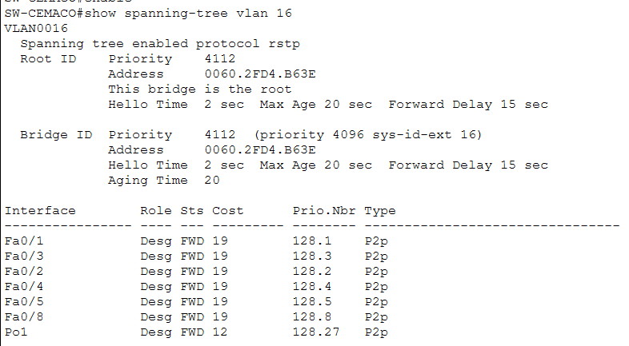
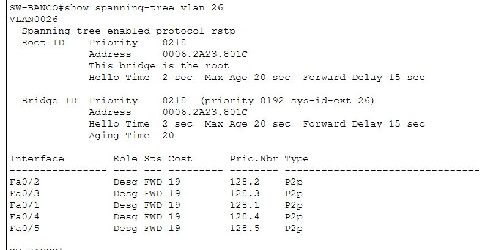
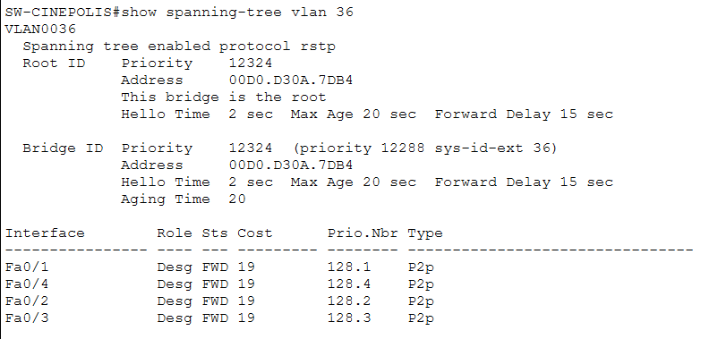
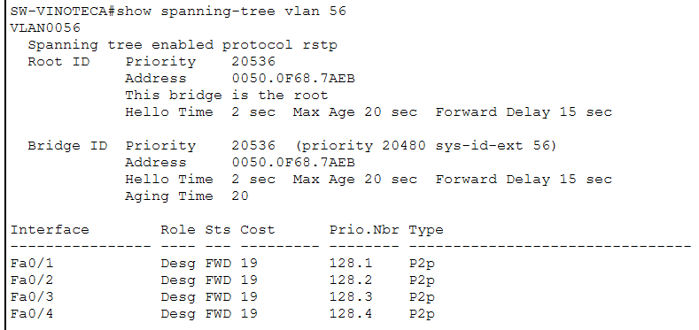
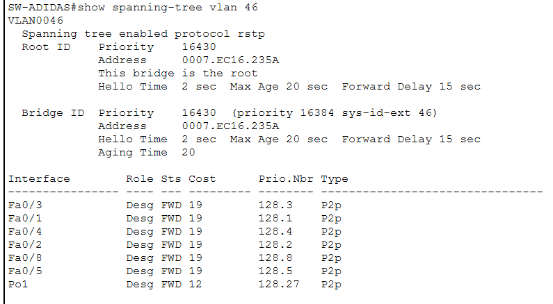

## 8. EtherChannel con LACP

El carnet finaliza en un número par, por lo que se utiliza **LACP**. Dos enlaces FastEthernet (`Fa0/6` y `Fa0/7`) entre SW-CEMACO y SW-ADIDAS integran `Port-channel1` como canal de capa 2.

Verificación observada en ambos extremos:

```text
Po1(SU)   LACP   Fa0/6(P) Fa0/7(P)
```

`SU` indica canal de capa 2 en uso y `(P)` indica interfaces físicas integradas. Este enlace está justificado por el tráfico y cantidad de hosts de CEMACO y Adidas. La disponibilidad de otros caminos físicos permite tolerar fallas sujetas a la reconvergencia de STP.

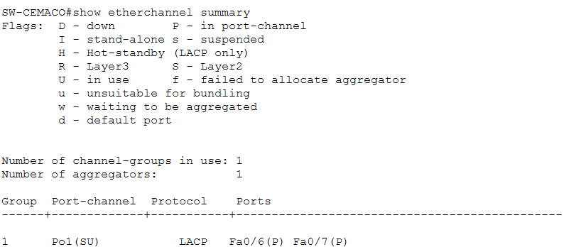
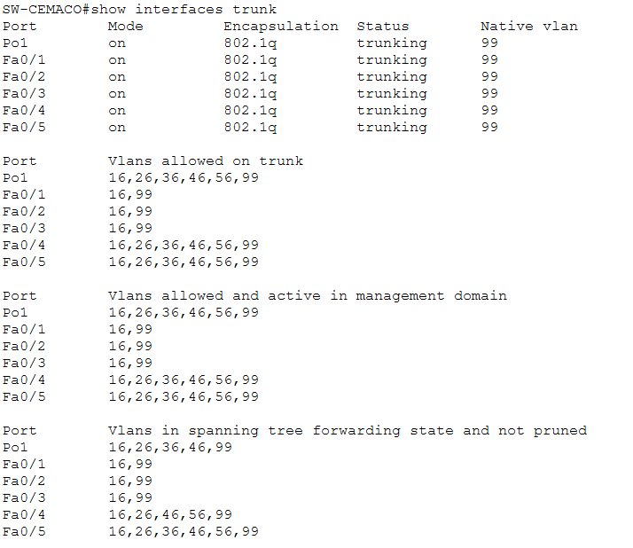

## 9. Enrutamiento inter-VLAN

SW-CEMACO es el switch multicapa que proporciona las cinco interfaces virtuales de VLAN (SVI) y tiene habilitado `ip routing`. Los demás switches principales participan en la interconexión de capa 2.

Configuración representativa del enrutamiento central:

```cisco
ip routing
interface vlan 16
 ip address 192.168.16.1 255.255.255.192
 no shutdown
interface vlan 26
 ip address 192.168.26.1 255.255.255.224
 no shutdown
interface vlan 36
 ip address 192.168.36.1 255.255.255.240
 no shutdown
interface vlan 46
 ip address 192.168.46.1 255.255.255.192
 no shutdown
interface vlan 56
 ip address 192.168.56.1 255.255.255.240
 no shutdown
```

El comando `show ip route` mostró las cinco subredes directamente conectadas durante el diagnóstico.

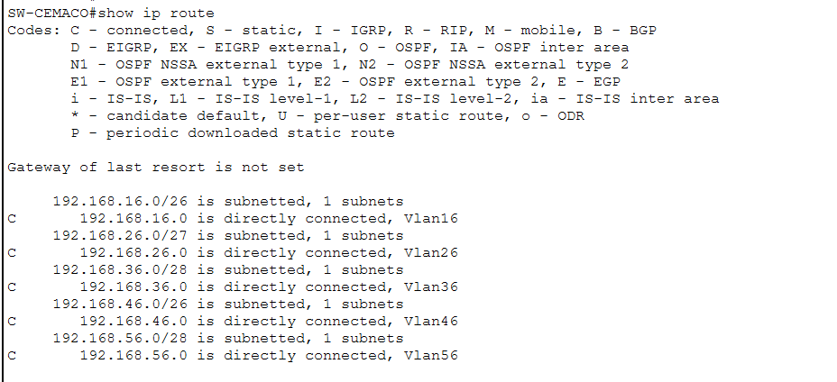

## 10. Dominios de colisión y difusión

Cada enlace Ethernet punto a punto conectado a un puerto de switch delimita su propio segmento físico (en full-duplex no hay colisiones reales). Para la topología representativa instalada, la cuenta del **diseño físico descrito** es:

| Enlaces físicos | Cantidad | Dominios de colisión por enlace |
|---|---:|---:|
| 10 switches de acceso hacia principales | 10 | 10 |
| 10 computadoras hacia switches de acceso | 10 | 10 |
| 5 servidores hacia switches principales | 5 | 5 |
| Anillo de cinco enlaces principales | 5 | 5 |
| Dos enlaces físicos LACP | 2 | 2 |
| **Total de enlaces físicos activos previstos** | **32** | **32** |

**Criterio:** se cuenta cada segmento físico Ethernet punto a punto; EtherChannel es una sola interfaz lógica de control, pero utiliza dos enlaces físicos independientes. Si se documentan *enlaces lógicos* en lugar de segmentos físicos, Po1 se representa como uno y resultan 31 conexiones lógicas. Contrastar el total con la topología `.pkt` definitiva antes de entregar.

Los dominios de *broadcast* de usuario están separados por las cinco VLANs 16, 26, 36, 46 y 56. La VLAN nativa 99 es otro dominio lógico separado; la VLAN 999 se reserva para puertos inutilizados. El enrutamiento entre subredes se realiza en SW-CEMACO.

## 11. Pruebas de funcionamiento

Las pruebas realizadas comprobaron comunicación de una computadora por switch de acceso, entre PCs de la misma VLAN y entre VLANs distintas mediante los gateways del 3560.

| Origen | Destino | Resultado registrado |
|---|---|---|
| CEM-PC2 | CEM-PC1, CEM-SERVER, BAN-SERVER | 2/2 respuestas en cada prueba |
| CEM-PC3 | CEM-PC1, CEM-PC2, BAN-SERVER | 2/2 respuestas en cada prueba |
| BAN-PC2 | BAN-PC1, BAN-SERVER, CEM-PC3 | 2/2 respuestas en cada prueba |
| CIN-PC1 | Gateways y PCs de las otras cuatro zonas | 4/4 respuestas por destino |
| ADI-PC2 | ADI-PC1, ADI-SERVER, CEM-SERVER | 2/2 respuestas por destino |
| ADI-PC3 | ADI-PC1, ADI-PC2, ADI-SERVER, CIN-SERVER | 2/2 respuestas por destino |
| VIN-SERVER | Gateway y los otros cuatro servidores | 4/4 respuestas por destino |

Los resultados 2/2 provienen de pruebas interrumpidas voluntariamente después de dos respuestas, con 0 % de pérdida entre los paquetes enviados. Otras pruebas se ejecutaron completas con 4/4 respuestas. Se verificaron rutas de comunicación entre las cinco zonas; para la entrega deben seleccionarse al menos diez pruebas de ping exitosas, con capturas legibles que identifiquen origen y destino.

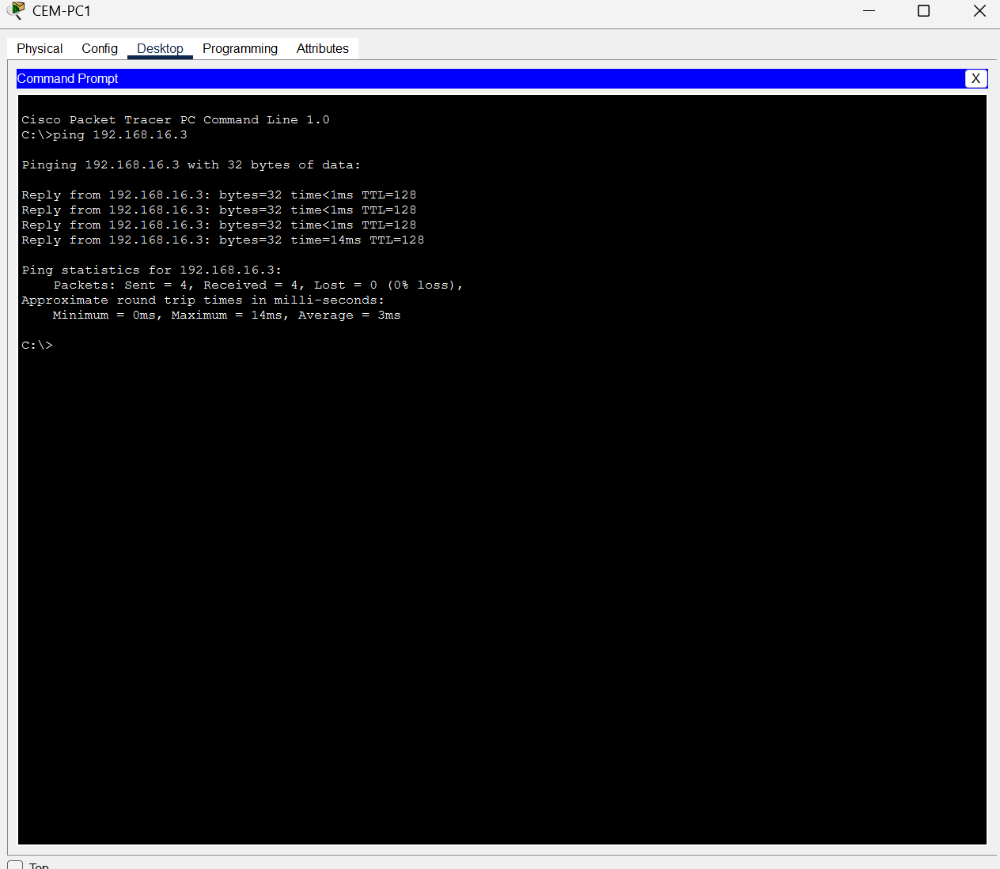
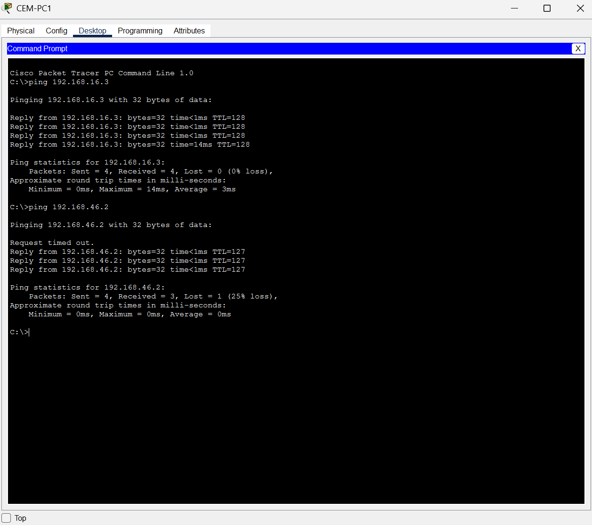

## 12. Incidencia durante la implementación y solución aplicada

Durante las pruebas iniciales, **ADI-PC1** y **CIN-PC1** no conseguían comunicarse de manera estable con sus gateways, aunque las configuraciones IP eran correctas. Los switches mostraban EtherChannel LACP operativo (`Po1(SU)`), pero los estados STP del canal presentaban comportamientos inconsistentes para determinadas VLANs.

Mediante **Simulation**, se observó que una solicitud ARP de ADI-PC1 llegaba a SW-CEMACO por `Fa0/6`, donde Packet Tracer informó:

```text
Port-channel1 is blocked by STP. The device drops the frame.
```

También se observó que `Po1` aparecía como `Root BLK` para VLAN 46, y la última sección de `show interfaces trunk` no la listaba en estado Forwarding.

Se ejecutó una recuperación controlada de la interfaz lógica en SW-CEMACO:

```cisco
configure terminal
interface port-channel 1
 shutdown
 no shutdown
end
```

Tras la reconvergencia, `Po1` quedó en `Root FWD` para la VLAN 46 y la VLAN se observó en estado Forwarding en la salida de trunks. Se repitieron las pruebas desde Adidas y Cinépolis y ambas zonas alcanzaron sus gateways y otras VLANs sin pérdidas en las pruebas finales.

**Interpretación limitada:** los resultados son compatibles con una inconsistencia transitoria entre STP y el canal agregado; no prueban de manera concluyente un defecto específico de Packet Tracer.

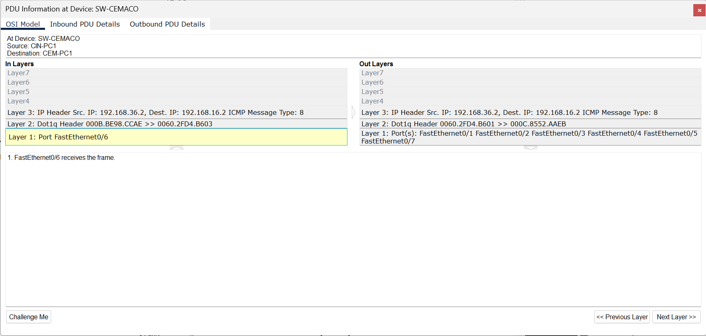
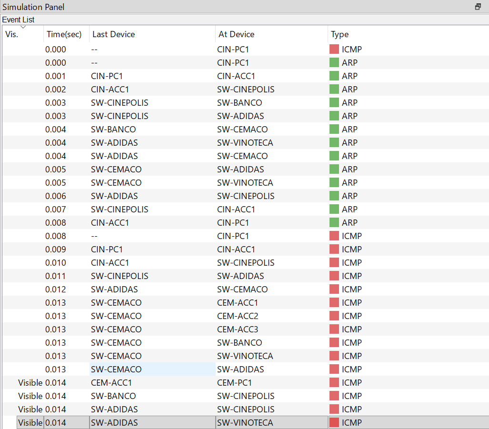

## 13. Registro final de funcionamiento

Se concluyó la construcción de la topología y se realizaron comprobaciones de capa 2 y capa 3. Los resultados satisfactorios comprenden:

| Componente | Estado final | Evidencia disponible |
|---|---|---|
| Cinco zonas y sus VLANs | Configuradas y con conectividad | Pruebas ICMP desde las cinco zonas |
| Cinco gateways en SW-CEMACO | Configurados y accesibles | `ping` a cada SVI, `show interfaces vlan` |
| Cinco servidores | Con IP estática y accesibles | `ipconfig` y `ping` |
| Diez PCs representativas | Una por switch de acceso | `ipconfig` y pruebas intra/inter-VLAN |
| VTP en cinco switches principales | Server, versión 2, dominio y revisión coincidentes | Salidas `show vtp status`, `show vtp password`, `show vlan brief` |
| VTP en diez switches de acceso | Client | Verificación comunicada por el estudiante; capturas a insertar |
| Rapid PVST+ | Root bridge designado por VLAN | `show spanning-tree vlan <ID>` |
| EtherChannel CEMACO–Adidas | LACP, `Po1(SU)`, dos interfaces `(P)` | `show etherchannel summary` |
| Enlaces Trunk | VLAN 99 nativa y listas permitidas específicas | `show interfaces trunk` |
| VLAN 999 Blackhole | En puertos no usados | `show vlan brief` y `show interfaces status` |

**Alcance exacto:** los cinco servidores tienen conectividad IP; no se afirma que estén publicados servicios de aplicación como DNS, DHCP o HTTP. La simulación contiene diez PCs representativas, no 157 PCs físicas. El dimensionamiento IP sí contempla las cantidades de hosts del enunciado.

## 14. Conclusiones técnicas

La topología implementada combina estrella extendida para el acceso y anillo redundante entre los switches principales, complementado con EtherChannel LACP en el enlace CEMACO–Adidas. La segmentación por VLAN separa los dominios de difusión, Rapid PVST+ previene bucles de capa 2 y SW-CEMACO realiza el enrutamiento inter-VLAN.

Las pruebas realizadas desde las PCs y servidores representativos confirmaron comunicación dentro de cada zona y entre establecimientos. Se comprobaron los cinco switches principales como servidores VTP y se confirmó el modo cliente en los diez switches de acceso. La incidencia de bloqueo STP en el canal agregado fue identificada mediante Simulation y se resolvió con la reconvergencia controlada de Port-channel1.


---